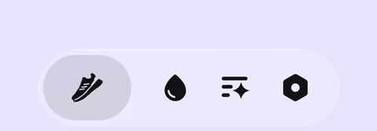
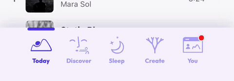
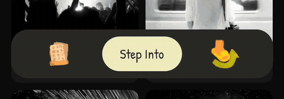
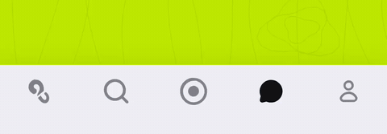
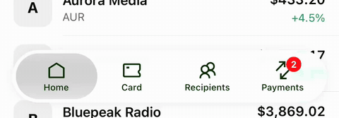
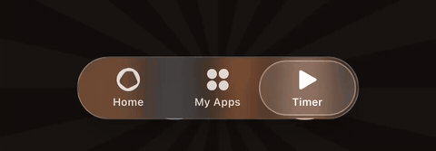

# tabcn

<a href="https://vanitascaesar1.github.io/tabcn/"></a>

Animated tab bars for React Native and Expo, in the style of shadcn/ui: install a small foundation package, then copy the design you want into your app and make it yours.

**[Browse all 20 designs →](https://vanitascaesar1.github.io/tabcn/)** Each one plays on a phone, and opens in Expo Go from a QR code.

> **Status: pre-release.** All 20 designs and the foundation are built ([`docs/designs/foundation.md`](docs/designs/foundation.md)). The `tabcn` package is not on npm yet, so `shadcn add` can copy a design but its `tabcn` dependency won't install until the first release. Until then, run the example app below.

## How it works

- **`tabcn` (npm package)** holds the parts every tab bar needs and that are easy to get wrong: connecting to the navigator, tab state, safe-area spacing, the animated active-tab highlight, press feedback, badges, haptics, reduced-motion support and accessibility. Bug fixes here reach everyone through `npm update`.
- **Designs ([`registry/`](registry/))** are short source files built on that foundation. You copy one into your project and own it. Change icons, labels and the number of tabs through props, or edit the file to change the look and motion.
- **Navigation** stays with your navigator. A tabcn design is passed as the `tabBar` of Expo Router's `<Tabs>` or React Navigation's bottom tabs, so screens, deep links, the Android back button and screen-reader roles keep working.

## Install a design

```bash
npx shadcn@latest add https://vanitascaesar1.github.io/tabcn/r/sliding-capsule.json
```

This copies the design and its icons into `components/tabcn/` and installs what it needs (`tabcn`, `expo-haptics`, `react-native-svg`, …). Every design's page on the site has its own command.

## Usage

```tsx
// app/(tabs)/_layout.tsx (Expo Router)
import { Tabs } from 'expo-router/js-tabs';
import { tabBar } from 'tabcn/expo-router'; // or 'tabcn/react-navigation'
import { SlidingCapsule } from '@/components/tabcn/sliding-capsule';

export default function TabLayout() {
  return (
    <Tabs tabBar={tabBar(<SlidingCapsule />)} screenOptions={{ headerShown: false }}>
      <Tabs.Screen name="index" options={{ title: 'Home', tabBarIcon: HomeIcon }} />
      <Tabs.Screen
        name="inbox"
        options={{ title: 'Inbox', tabBarIcon: InboxIcon, tabBarBadge: 3 }}
      />
    </Tabs>
  );
}
```

Icons, labels, badges and the number of tabs come from the screens' options, as with the default tab bar. Floating designs report their height, so screens can pad lists with `useBottomTabBarHeight()`.

## The 20 designs

Every design animates: tap to see the active tab move. Click one to open its page, with the install command and a QR code for Expo Go.

<table>
<tr><td align="center" width="50%"><a href="https://vanitascaesar1.github.io/tabcn/designs/glass-expand/"></a><br><b>01 · Glass Expand</b><br><sub>Floating pill</sub></td><td align="center" width="50%"><a href="https://vanitascaesar1.github.io/tabcn/designs/top-notch/"></a><br><b>02 · Top Notch</b><br><sub>Docked bar</sub></td></tr>
<tr><td align="center" width="50%"><a href="https://vanitascaesar1.github.io/tabcn/designs/chip-rail/"></a><br><b>03 · Chip Rail</b><br><sub>Chip rail</sub></td><td align="center" width="50%"><a href="https://vanitascaesar1.github.io/tabcn/designs/sticker-tiles/"></a><br><b>04 · Sticker Tiles</b><br><sub>Docked bar</sub></td></tr>
<tr><td align="center" width="50%"><a href="https://vanitascaesar1.github.io/tabcn/designs/segment-search/"></a><br><b>05 · Segment + Search</b><br><sub>Pill + action button</sub></td><td align="center" width="50%"><a href="https://vanitascaesar1.github.io/tabcn/designs/pill-plus/"></a><br><b>06 · Pill + Plus</b><br><sub>Pill + action button</sub></td></tr>
<tr><td align="center" width="50%"><a href="https://vanitascaesar1.github.io/tabcn/designs/solid-dark/"></a><br><b>07 · Solid Dark</b><br><sub>Docked bar</sub></td><td align="center" width="50%"><a href="https://vanitascaesar1.github.io/tabcn/designs/outline-dark/"></a><br><b>08 · Outline Dark</b><br><sub>Docked bar</sub></td></tr>
<tr><td align="center" width="50%"><a href="https://vanitascaesar1.github.io/tabcn/designs/orbs/"></a><br><b>09 · Orbs</b><br><sub>Floating buttons</sub></td><td align="center" width="50%"><a href="https://vanitascaesar1.github.io/tabcn/designs/center-cta/"></a><br><b>10 · Center CTA</b><br><sub>Center action</sub></td></tr>
<tr><td align="center" width="50%"><a href="https://vanitascaesar1.github.io/tabcn/designs/soft-pill/"></a><br><b>11 · Soft Pill</b><br><sub>Floating pill</sub></td><td align="center" width="50%"><a href="https://vanitascaesar1.github.io/tabcn/designs/dark-capsule/"></a><br><b>12 · Dark Capsule</b><br><sub>Docked bar</sub></td></tr>
<tr><td align="center" width="50%"><a href="https://vanitascaesar1.github.io/tabcn/designs/gradient-stickers/"></a><br><b>13 · Gradient Stickers</b><br><sub>Floating pill</sub></td><td align="center" width="50%"><a href="https://vanitascaesar1.github.io/tabcn/designs/light-icons/"></a><br><b>14 · Light Icons</b><br><sub>Docked bar</sub></td></tr>
<tr><td align="center" width="50%"><a href="https://vanitascaesar1.github.io/tabcn/designs/playful-tiles/"></a><br><b>15 · Playful Tiles</b><br><sub>Docked bar</sub></td><td align="center" width="50%"><a href="https://vanitascaesar1.github.io/tabcn/designs/sliding-capsule/"></a><br><b>16 · Sliding Capsule</b><br><sub>Floating pill</sub></td></tr>
<tr><td align="center" width="50%"><a href="https://vanitascaesar1.github.io/tabcn/designs/labeled-plus/"></a><br><b>17 · Labeled + Plus</b><br><sub>Pill + action button</sub></td><td align="center" width="50%"><a href="https://vanitascaesar1.github.io/tabcn/designs/frosted-media/"></a><br><b>18 · Frosted Media</b><br><sub>Floating pill</sub></td></tr>
<tr><td align="center" width="50%"><a href="https://vanitascaesar1.github.io/tabcn/designs/glow-glass/"></a><br><b>19 · Glow Glass</b><br><sub>Pill + action button</sub></td><td align="center" width="50%"><a href="https://vanitascaesar1.github.io/tabcn/designs/mono-type/"></a><br><b>20 · Mono Type</b><br><sub>Docked bar</sub></td></tr>
</table>

Names are working names. The source of truth is [`apps/example/src/catalog.ts`](apps/example/src/catalog.ts).

## Repository layout

```
apps/example/      Expo SDK 58 app (Expo Router) that shows every design
apps/site/         the website (Next.js, static export to GitHub Pages)
packages/tabcn/    the foundation npm package
registry/          the copyable designs, one folder each
docs/designs/      design docs, written before the code they describe
references/        local-only reference images (git-ignored; see its README)
tools/trace/       scripts that traced the designs' icons from the references
```

## Try it on your phone

Install [Expo Go](https://expo.dev/go), then scan the QR code on any design's page on the site. It opens the example app, published with EAS Update, straight on that design. The app's gallery lists all 20, and its React Navigation screen runs each design under `@react-navigation/bottom-tabs`.

## Development

Requires [Bun](https://bun.sh) 1.4+ and Node 22+. iOS needs Xcode; Android needs Android Studio.

```bash
bun install        # install everything (workspaces)
bun run example    # start Metro for the example app
bun run ios        # or open it in the iOS simulator
bun run check      # lint + typecheck + registry check + tests + build, the same as CI
```

The example app imports `tabcn` from `packages/tabcn/src` directly (through the `tabcn-source` export condition), so edits to the package show up on reload with no build step.

See [CONTRIBUTING.md](CONTRIBUTING.md) for the workflow and release process.

## Credits

The 20 designs recreate the tab bars collected in the "tab bar pillars" post by [@jaimintf](https://x.com/jaimintf/status/2123071132224077889). The website's design is based on [ui lab](https://lab.xevrion.dev/) by xevrion (MIT).

## License

[MIT](LICENSE)
