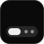

# tabcn

<a href="https://vanitascaesar1.github.io/tabcn/"></a>

Animated tab bars for React Native and Expo, in the style of shadcn/ui: install a small foundation package, then copy the design you want into your app and make it yours.

**[Browse all 47 designs →](https://vanitascaesar1.github.io/tabcn/)** Each one opens in Expo Go from a QR code and plays on a phone in the page.

> **Status: 0.x.** All 47 designs (39 tab bars and 8 panels) and the foundation are built. The foundation is on npm as [`react-native-tabcn`](https://www.npmjs.com/package/react-native-tabcn) (npm turned down the bare name `tabcn` as too close to `table`). Before 1.0, a minor release may change its API; the changelog says so when it does.

## How it works

- **`react-native-tabcn` (npm package)** holds the parts every tab bar needs and that are easy to get wrong: connecting to the navigator, tab state, safe-area spacing, the animated active-tab highlight, press feedback, badges, haptics, reduced-motion support and accessibility. Bug fixes here reach everyone through `npm update`.
- **Designs ([`registry/`](registry/))** are short source files built on that foundation. You copy one into your project and own it. Change icons, labels and the number of tabs through props, or edit the file to change the look and motion.
- **Navigation** stays with your navigator. A tabcn design is passed as the `tabBar` of Expo Router's `<Tabs>` or React Navigation's bottom tabs, so screens, deep links, the Android back button and screen-reader roles keep working.

## Install a design

```bash
npx shadcn@latest add https://vanitascaesar1.github.io/tabcn/r/sliding-capsule.json
```

This copies the design and its icons into `components/tabcn/` (or `src/components/tabcn/` if your app has a `src` folder) and installs what it needs (`react-native-tabcn`, `expo-haptics`, `react-native-svg`, …). No `components.json` or Tailwind setup is needed. Every design's page on the site has its own command.

shadcn installs those packages at their latest npm versions, so then line them up with your Expo SDK:

```bash
npx expo install --fix
```

## Usage

```tsx
// app/(tabs)/_layout.tsx (Expo Router)
import { Tabs } from 'expo-router/js-tabs';
import { tabBar } from 'react-native-tabcn/expo-router'; // or 'react-native-tabcn/react-navigation'
import { SlidingCapsule } from '@/components/tabcn/sliding-capsule';

export default function TabLayout() {
  return (
    <Tabs tabBar={tabBar(<SlidingCapsule />)} screenOptions={{ headerShown: false }}>
      <Tabs.Screen name="index" options={{ title: 'Home', tabBarIcon: HomeIcon }} />
      <Tabs.Screen
        name="inbox"
        options={{ title: 'Inbox', tabBarIcon: InboxIcon, tabBarBadge: 3 }}
      />
    </Tabs>
  );
}
```

Icons, labels, badges and the number of tabs come from the screens' options, as with the default tab bar. Floating designs report their height, so screens can pad lists with `useBottomTabBarHeight()`.

## Docs

The docs are on the site:

- [Introduction](https://vanitascaesar1.github.io/tabcn/docs/): how it works, requirements, install, React Navigation
- [Using with PanelUI](https://vanitascaesar1.github.io/tabcn/docs/panelui/): designs that follow a PanelUI theme
- Guides: [Panels](https://vanitascaesar1.github.io/tabcn/docs/panels/) · [Sheets](https://vanitascaesar1.github.io/tabcn/docs/sheets/) · [Minimize on scroll](https://vanitascaesar1.github.io/tabcn/docs/minimize-on-scroll/) · [Companions](https://vanitascaesar1.github.io/tabcn/docs/companions/) · [Toasts](https://vanitascaesar1.github.io/tabcn/docs/toasts/) · [Sub-tabs](https://vanitascaesar1.github.io/tabcn/docs/sub-tabs/) · [Sheet navigation](https://vanitascaesar1.github.io/tabcn/docs/sheet-navigation/) · [Scrubbing](https://vanitascaesar1.github.io/tabcn/docs/scrubbing/) · [Live tabs](https://vanitascaesar1.github.io/tabcn/docs/live-tabs/)

## The 47 designs

Every design animates: tap to see the active tab move. Click one to open its page, with the install command and a QR code for Expo Go.

### Tab bars

<table>
<tr><td align="center" width="50%"><a href="https://vanitascaesar1.github.io/tabcn/designs/glass-expand/"></a><br><b>01 · Glass Expand</b><br><sub>Floating pill</sub></td><td align="center" width="50%"><a href="https://vanitascaesar1.github.io/tabcn/designs/top-notch/"></a><br><b>02 · Top Notch</b><br><sub>Docked bar</sub></td></tr>
<tr><td align="center" width="50%"><a href="https://vanitascaesar1.github.io/tabcn/designs/chip-rail/"></a><br><b>03 · Chip Rail</b><br><sub>Chip rail</sub></td><td align="center" width="50%"><a href="https://vanitascaesar1.github.io/tabcn/designs/sticker-tiles/"></a><br><b>04 · Sticker Tiles</b><br><sub>Docked bar</sub></td></tr>
<tr><td align="center" width="50%"><a href="https://vanitascaesar1.github.io/tabcn/designs/segment-search/"></a><br><b>05 · Segment + Search</b><br><sub>Pill + action button</sub></td><td align="center" width="50%"><a href="https://vanitascaesar1.github.io/tabcn/designs/pill-plus/"></a><br><b>06 · Pill + Plus</b><br><sub>Pill + action button</sub></td></tr>
<tr><td align="center" width="50%"><a href="https://vanitascaesar1.github.io/tabcn/designs/solid-dark/"></a><br><b>07 · Solid Dark</b><br><sub>Docked bar</sub></td><td align="center" width="50%"><a href="https://vanitascaesar1.github.io/tabcn/designs/outline-dark/">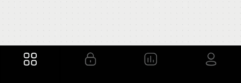</a><br><b>08 · Outline Dark</b><br><sub>Docked bar</sub></td></tr>
<tr><td align="center" width="50%"><a href="https://vanitascaesar1.github.io/tabcn/designs/orbs/">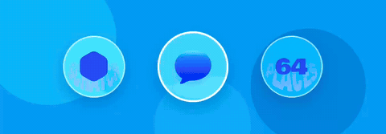</a><br><b>09 · Orbs</b><br><sub>Floating buttons</sub></td><td align="center" width="50%"><a href="https://vanitascaesar1.github.io/tabcn/designs/center-cta/"></a><br><b>10 · Center CTA</b><br><sub>Center action</sub></td></tr>
<tr><td align="center" width="50%"><a href="https://vanitascaesar1.github.io/tabcn/designs/soft-pill/"></a><br><b>11 · Soft Pill</b><br><sub>Floating pill</sub></td><td align="center" width="50%"><a href="https://vanitascaesar1.github.io/tabcn/designs/dark-capsule/">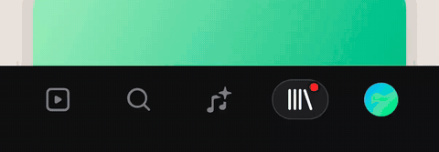</a><br><b>12 · Dark Capsule</b><br><sub>Docked bar</sub></td></tr>
<tr><td align="center" width="50%"><a href="https://vanitascaesar1.github.io/tabcn/designs/gradient-stickers/"></a><br><b>13 · Gradient Stickers</b><br><sub>Floating pill</sub></td><td align="center" width="50%"><a href="https://vanitascaesar1.github.io/tabcn/designs/light-icons/"></a><br><b>14 · Dark Icons</b><br><sub>Docked bar</sub></td></tr>
<tr><td align="center" width="50%"><a href="https://vanitascaesar1.github.io/tabcn/designs/playful-tiles/">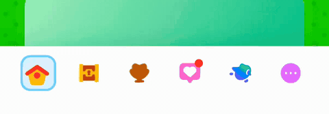</a><br><b>15 · Playful Tiles</b><br><sub>Docked bar</sub></td><td align="center" width="50%"><a href="https://vanitascaesar1.github.io/tabcn/designs/sliding-capsule/"></a><br><b>16 · Sliding Capsule</b><br><sub>Floating pill</sub></td></tr>
<tr><td align="center" width="50%"><a href="https://vanitascaesar1.github.io/tabcn/designs/labeled-plus/">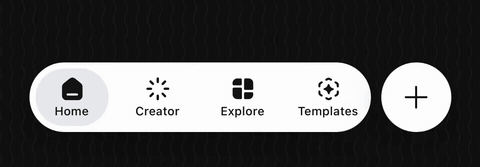</a><br><b>17 · Labeled + Plus</b><br><sub>Pill + action button</sub></td><td align="center" width="50%"><a href="https://vanitascaesar1.github.io/tabcn/designs/frosted-media/"></a><br><b>18 · Frosted Media</b><br><sub>Floating pill</sub></td></tr>
<tr><td align="center" width="50%"><a href="https://vanitascaesar1.github.io/tabcn/designs/glow-glass/"></a><br><b>19 · Glow Glass</b><br><sub>Pill + action button</sub></td><td align="center" width="50%"><a href="https://vanitascaesar1.github.io/tabcn/designs/mono-type/">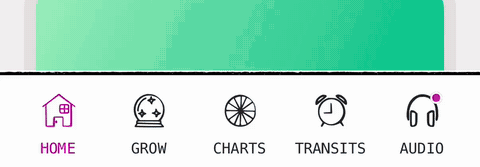</a><br><b>20 · Mono Type</b><br><sub>Docked bar</sub></td></tr>
<tr><td align="center" width="50%"><a href="https://vanitascaesar1.github.io/tabcn/designs/split-search/"></a><br><b>Split Search</b><br><sub>Pill + action button</sub></td><td align="center" width="50%"><a href="https://vanitascaesar1.github.io/tabcn/designs/material-pill/">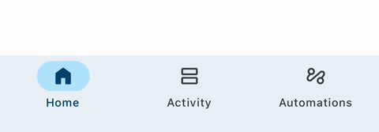</a><br><b>Material Pill</b><br><sub>Docked bar</sub></td></tr>
<tr><td align="center" width="50%"><a href="https://vanitascaesar1.github.io/tabcn/designs/side-rail/"></a><br><b>Side Rail</b><br><sub>Side rail</sub></td><td align="center" width="50%"><a href="https://vanitascaesar1.github.io/tabcn/designs/search-dock/">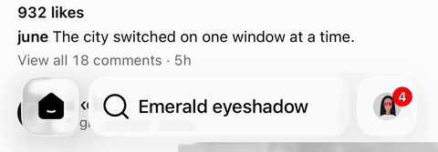</a><br><b>Search Dock</b><br><sub>Floating buttons</sub></td></tr>
<tr><td align="center" width="50%"><a href="https://vanitascaesar1.github.io/tabcn/designs/button-row/">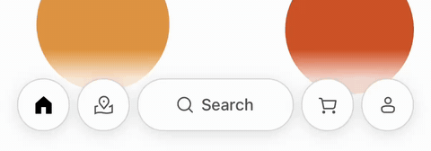</a><br><b>Button Row</b><br><sub>Floating buttons</sub></td><td align="center" width="50%"><a href="https://vanitascaesar1.github.io/tabcn/designs/color-flood/"></a><br><b>Colour Flood</b><br><sub>Docked bar</sub></td></tr>
<tr><td align="center" width="50%"><a href="https://vanitascaesar1.github.io/tabcn/designs/accent-dark/">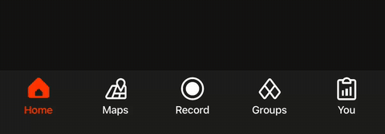</a><br><b>Accent Dark</b><br><sub>Docked bar</sub></td><td align="center" width="50%"><a href="https://vanitascaesar1.github.io/tabcn/designs/tile-plus/">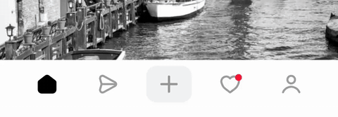</a><br><b>Tile Plus</b><br><sub>Center action</sub></td></tr>
<tr><td align="center" width="50%"><a href="https://vanitascaesar1.github.io/tabcn/designs/offset-plus/">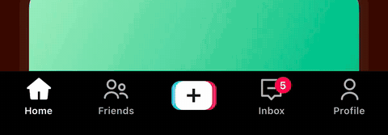</a><br><b>Offset Plus</b><br><sub>Center action</sub></td><td align="center" width="50%"><a href="https://vanitascaesar1.github.io/tabcn/designs/tinted-icons/"></a><br><b>Tinted Icons</b><br><sub>Docked bar</sub></td></tr>
<tr><td align="center" width="50%"><a href="https://vanitascaesar1.github.io/tabcn/designs/badge-dock/"></a><br><b>Badge Dock</b><br><sub>Docked bar</sub></td><td align="center" width="50%"><a href="https://vanitascaesar1.github.io/tabcn/designs/cart-pill/">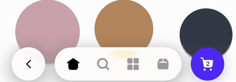</a><br><b>Cart Pill</b><br><sub>Pill + action button</sub></td></tr>
<tr><td align="center" width="50%"><a href="https://vanitascaesar1.github.io/tabcn/designs/glass-badges/"></a><br><b>Glass Badges</b><br><sub>Pill + action button</sub></td><td align="center" width="50%"><a href="https://vanitascaesar1.github.io/tabcn/designs/section-sheet/">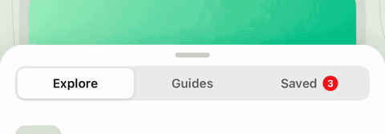</a><br><b>Section Sheet</b><br><sub>Sheet</sub></td></tr>
<tr><td align="center" width="50%"><a href="https://vanitascaesar1.github.io/tabcn/designs/scrub-pill/"></a><br><b>Scrub Pill</b><br><sub>Floating pill</sub></td><td align="center" width="50%"><a href="https://vanitascaesar1.github.io/tabcn/designs/live-tabs/">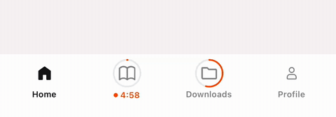</a><br><b>Live Tabs</b><br><sub>Docked bar</sub></td></tr>
<tr><td align="center" width="50%"><a href="https://vanitascaesar1.github.io/tabcn/designs/composer-dock/"></a><br><b>Composer Dock</b><br><sub>Docked bar</sub></td><td align="center" width="50%"><a href="https://vanitascaesar1.github.io/tabcn/designs/account-dock/">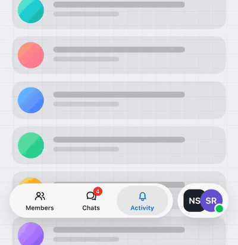</a><br><b>Account Dock</b><br><sub>Pill + action button</sub></td></tr>
<tr><td align="center" width="50%"><a href="https://vanitascaesar1.github.io/tabcn/designs/ambient-bar/">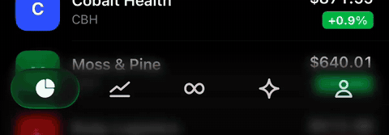</a><br><b>Ambient Bar</b><br><sub>Docked bar</sub></td><td></td></tr>
</table>

### Panels

Each is shown with the tab bar it pairs with in the example app. Mini Player, Context Tray, Bar Sheet, Companion Chip, Filter Chips and Slider Sheet work with any tabcn bar; Quick Create needs a bar whose + button is marked with `usePanelAnchor('action')` (Labeled + Plus, Pill + Plus, Glow Glass, Segment + Search and Center CTA are), and Sub-Tabs a bar whose tab calls `useSubTabs(name)`.

<table>
<tr><td align="center" width="50%"><a href="https://vanitascaesar1.github.io/tabcn/designs/mini-player/">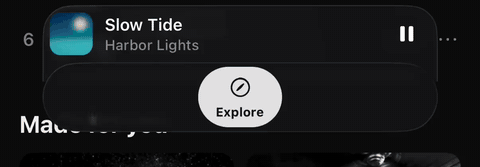</a><br><b>Mini Player</b><br><sub> · with Soft Pill</sub></td><td align="center" width="50%"><a href="https://vanitascaesar1.github.io/tabcn/designs/context-tray/"></a><br><b>Context Tray</b><br><sub> · with Glass Expand</sub></td></tr>
<tr><td align="center" width="50%"><a href="https://vanitascaesar1.github.io/tabcn/designs/quick-create/">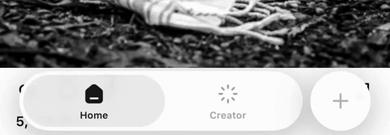</a><br><b>Quick Create</b><br><sub> · with Labeled + Plus</sub></td><td align="center" width="50%"><a href="https://vanitascaesar1.github.io/tabcn/designs/bar-sheet/">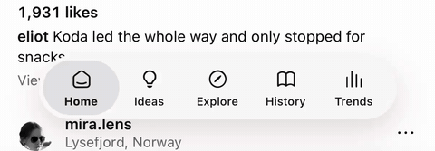</a><br><b>Bar Sheet</b><br><sub>with Soft Pill</sub></td></tr>
<tr><td align="center" width="50%"><a href="https://vanitascaesar1.github.io/tabcn/designs/companion-chip/"></a><br><b>Companion Chip</b><br><sub>with Split Search</sub></td><td align="center" width="50%"><a href="https://vanitascaesar1.github.io/tabcn/designs/sub-tabs/">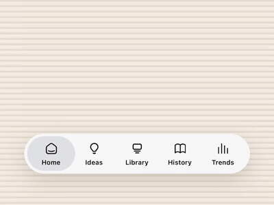</a><br><b>Sub-Tabs</b><br><sub>with a Soft Pill copy</sub></td></tr>
<tr><td align="center" width="50%"><a href="https://vanitascaesar1.github.io/tabcn/designs/filter-chips/">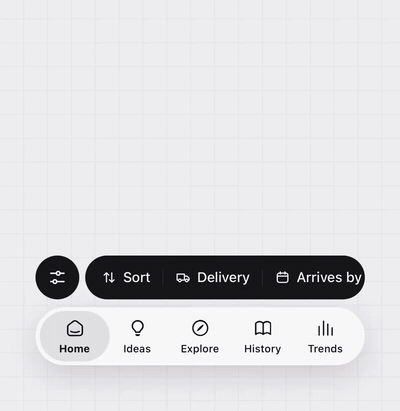</a><br><b>Filter Chips</b><br><sub>with Soft Pill</sub></td><td align="center" width="50%"><a href="https://vanitascaesar1.github.io/tabcn/designs/slider-sheet/">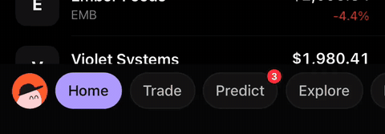</a><br><b>Slider Sheet</b><br><sub>with Chip Rail</sub></td></tr>
</table>

## Repository layout

```
apps/example/      Expo SDK 58 app (Expo Router) that shows every design
apps/site/         the website (Next.js, static export to GitHub Pages)
packages/tabcn/    the foundation npm package
registry/          the copyable designs, one folder each
docs/designs/      design docs, written before the code they describe
references/        local-only reference images (git-ignored; see its README)
tools/trace/       scripts that traced the designs' icons from the references
```

## Try it on your phone

Install [Expo Go](https://expo.dev/go), then scan the QR code on any design's page on the site. It opens the example app, published with EAS Update, straight on that design. The app's gallery lists all 47, and its React Navigation screen runs each design under `@react-navigation/bottom-tabs`.

## Development

Requires [Bun](https://bun.sh) 1.4+ and Node 22+. iOS needs Xcode; Android needs Android Studio.

```bash
bun install        # install everything (workspaces)
bun run example    # start Metro for the example app
bun run ios        # or open it in the iOS simulator
bun run check      # lint + typecheck + registry check + tests + build, the same as CI
```

The example app imports `react-native-tabcn` from `packages/tabcn/src` directly (through the `tabcn-source` export condition), so edits to the package show up on reload with no build step.

See [CONTRIBUTING.md](CONTRIBUTING.md) for the workflow and release process.

## Credits

Made by Chakravarthi Chintapatla ([@phantommenace_x](https://x.com/phantommenace_x) on X).

The first 20 tab bars recreate the ones collected in the "tab bar pillars" post by [@jaimintf](https://x.com/jaimintf/status/2123071132224077889).

## License

[MIT](LICENSE)
