# tabcn

<a href="https://vanitascaesar1.github.io/tabcn/"></a>

Animated tab bars for React Native and Expo, in the style of shadcn/ui: install a small foundation package, then copy the design you want into your app and make it yours.

**[Browse all 42 designs →](https://vanitascaesar1.github.io/tabcn/)** Each one opens in Expo Go from a QR code and plays on a phone in the page.

> **Status: 0.x.** All 42 designs (36 tab bars and 6 panels) and the foundation are built ([`docs/designs/foundation.md`](docs/designs/foundation.md)). The foundation is on npm as [`react-native-tabcn`](https://www.npmjs.com/package/react-native-tabcn) (npm turned down the bare name `tabcn` as too close to `table`). Before 1.0, a minor release may change its API; the changelog says so when it does.

## How it works

- **`react-native-tabcn` (npm package)** holds the parts every tab bar needs and that are easy to get wrong: connecting to the navigator, tab state, safe-area spacing, the animated active-tab highlight, press feedback, badges, haptics, reduced-motion support and accessibility. Bug fixes here reach everyone through `npm update`.
- **Designs ([`registry/`](registry/))** are short source files built on that foundation. You copy one into your project and own it. Change icons, labels and the number of tabs through props, or edit the file to change the look and motion.
- **Navigation** stays with your navigator. A tabcn design is passed as the `tabBar` of Expo Router's `<Tabs>` or React Navigation's bottom tabs, so screens, deep links, the Android back button and screen-reader roles keep working.

## Install a design

```bash
npx shadcn@latest add https://vanitascaesar1.github.io/tabcn/r/sliding-capsule.json
```

This copies the design and its icons into `components/tabcn/` (or `src/components/tabcn/` if your app has a `src` folder) and installs what it needs (`react-native-tabcn`, `expo-haptics`, `react-native-svg`, …). No `components.json` or Tailwind setup is needed. Every design's page on the site has its own command.

shadcn installs those packages at their latest npm versions, so then line them up with your Expo SDK:

```bash
npx expo install --fix
```

## Usage

```tsx
// app/(tabs)/_layout.tsx (Expo Router)
import { Tabs } from 'expo-router/js-tabs';
import { tabBar } from 'react-native-tabcn/expo-router'; // or 'react-native-tabcn/react-navigation'
import { SlidingCapsule } from '@/components/tabcn/sliding-capsule';

export default function TabLayout() {
  return (
    <Tabs tabBar={tabBar(<SlidingCapsule />)} screenOptions={{ headerShown: false }}>
      <Tabs.Screen name="index" options={{ title: 'Home', tabBarIcon: HomeIcon }} />
      <Tabs.Screen
        name="inbox"
        options={{ title: 'Inbox', tabBarIcon: InboxIcon, tabBarBadge: 3 }}
      />
    </Tabs>
  );
}
```

Icons, labels, badges and the number of tabs come from the screens' options, as with the default tab bar. Floating designs report their height, so screens can pad lists with `useBottomTabBarHeight()`.

### Panels

Panels are surfaces that live behind the tab bar and slide out of it: a mini player that peeks above the bar, a create menu from its + button, or a screen's own controls in the bar's place. Mini Player and Context Tray work with any tabcn bar. Quick Create slides out of the bar's + button, so it needs a bar that marks that button with `usePanelAnchor('action')`: Center CTA, Glow Glass, Labeled + Plus, Pill + Plus or Segment + Search. Put a `TabBarProvider` around the tabs navigator and declare the panel beside it, so it stays across tabs:

```tsx
// app/(tabs)/_layout.tsx
import { Tabs } from 'expo-router/js-tabs';
import { TabBarProvider } from 'react-native-tabcn';
import { tabBar } from 'react-native-tabcn/expo-router';
import { MiniPlayer } from '@/components/tabcn/mini-player';
import { SoftPill } from '@/components/tabcn/soft-pill';

export default function TabLayout() {
  return (
    <TabBarProvider>
      <Tabs tabBar={tabBar(<SoftPill />)} screenOptions={{ headerShown: false }} />
      <MiniPlayer track={track} playing={playing} onPlayPause={toggle} onNext={next} />
    </TabBarProvider>
  );
}
```

Any component under the provider controls it with `useTabPanel('player')` (`peek()`, `open()`, `hide()`, `toggle()`). A screen can replace the tabs while it is focused with `useTabBarOverride(<ContextTray … />)` from `react-native-tabcn/expo-router`. Dragging a panel (`react-native-tabcn/gestures`) needs `react-native-gesture-handler` and a `GestureHandlerRootView` around the app. Without a provider, the bar renders exactly as before. See [`docs/designs/panels.md`](docs/designs/panels.md).

### Minimize on scroll

Bars that support it (such as Split Search) shrink to a compact form while a screen scrolls down, as iOS 26's tab bars do, and come back when it scrolls up, reaches the top, or the bar is tapped. It needs the same `TabBarProvider` around the tabs navigator; a screen opts in with `useMinimizeOnScroll()`:

```tsx
// app/(tabs)/_layout.tsx
export default function TabLayout() {
  return (
    <TabBarProvider>
      <Tabs tabBar={tabBar(<SplitSearch />)} screenOptions={{ headerShown: false }} />
    </TabBarProvider>
  );
}
```

```tsx
// app/(tabs)/index.tsx
import Animated from 'react-native-reanimated';
import { useMinimizeOnScroll } from 'react-native-tabcn';

export default function Home() {
  const onScroll = useMinimizeOnScroll();
  return <Animated.FlatList data={items} renderItem={renderItem} onScroll={onScroll} />;
}
```

See [`docs/designs/motion-and-rail.md`](docs/designs/motion-and-rail.md), which also covers the side rail for tablets (`tabBarPosition: 'left'`).

### Sheets

A panel with `snapPoints` is a sheet: it rises from the bottom edge, passing behind the bar, to its lowest snap point, and dragging its header moves it between them. Bar Sheet is one, ready to copy. It needs the `TabBarProvider` and, for dragging, a `GestureHandlerRootView` around the app:

```tsx
// app/(tabs)/_layout.tsx: declared beside <Tabs>, so it stays across tabs
export default function TabLayout() {
  return (
    <TabBarProvider>
      <Tabs tabBar={tabBar(<SoftPill />)} screenOptions={{ headerShown: false }} />
      <BarSheet title="Comments" subtitle="128 replies">
        <CommentList />
      </BarSheet>
    </TabBarProvider>
  );
}

// Anywhere under the provider
function CommentsButton() {
  const sheet = useBarSheet(); // useTabPanel('sheet')
  // open() goes to the lowest snap point and snapTo(1) to the next; sheet.snap says where it rests.
  return <Button title="Comments" onPress={sheet.open} />;
}
```

To build your own, pass `snapPoints` (points or percentages of the screen, lowest first) to `TabPanel`, put the header in `PanelDragArea` and the body in `PanelScrollView` (both from `react-native-tabcn/gestures`). The sheet is modal only at its highest snap point, and with a screen reader on it opens straight to it.

### Companions

`TabBarCompanion` puts a small control against the bar, such as a locate button or a "32 views" chip, without magic numbers. It follows the bar when it minimizes, slides away with it for the keyboard, rides above a peeking mini player, and fades while a panel is open:

```tsx
// In the Map screen: shown while it is focused
function LocateButton() {
  const focused = useIsFocused();
  return (
    <TabBarCompanion position="above-end" visible={focused}>
      <CompanionChip
        variant="round"
        icon={LocateIcon}
        accessibilityLabel="Locate me"
        onPress={recenter}
      />
    </TabBarCompanion>
  );
}
```

`position` is `'above'`, `'above-start'`, `'above-end'`, or `'start'` and `'end'` beside a floating bar; start and end mirror in right-to-left layouts.

### Toasts

`useTabBarInset()` is the distance from the screen's bottom edge to the top of what tabcn draws there: the bar and its gap, a peeking panel, and companions above the bar. It works anywhere under the `TabBarProvider`, so you can put the provider around your root stack and hand the number to your toast library:

```tsx
function Toasts() {
  return <Toaster bottomOffset={useTabBarInset() + 8} />;
}
```

It is 0 while the keyboard is up (your toast library adds the keyboard itself), for a side rail, and while a screen or modal covers the tabs. With the provider above the root stack, use one tab navigator per provider, and don't declare panels, companions or overrides from modals or pushed root-stack screens: they would reach the bar underneath.

### Sub-tabs

`TabButton` takes `onLongPress`, which runs after the navigator's `tabLongPress` event and is offered to VoiceOver and TalkBack as a named action. The Sub-Tabs design uses it for a drawer that slides up from behind one tab. The tab spreads what `useSubTabs(name)` returns, and the drawer is declared beside the navigator:

```tsx
// In your bar design:
function LibraryTab({ tab }: { tab: TabItem }) {
  const sub = useSubTabs('library', { width: 168 });
  return (
    <TabButton tab={tab} {...sub.tabProps}>
      <LibraryIcon />
      <View {...sub.anchorProps} />
    </TabButton>
  );
}

// app/(tabs)/_layout.tsx: the drawer, beside <Tabs>
export default function TabLayout() {
  return (
    <TabBarProvider>
      <Tabs tabBar={tabBar(<MyTabBar />)} screenOptions={{ headerShown: false }} />
      <SubTabs
        name="library"
        items={[
          { label: 'Albums', onPress: openAlbums },
          { label: 'Artists', onPress: openArtists },
        ]}
      />
    </TabBarProvider>
  );
}
```

### Sheet navigation

Section Sheet replaces the bar with one sheet over full-screen content (a map, a canvas) whose header holds the sections. It is still a real tab navigator, so deep links and Android back keep working; each section's sheet body comes from `sections`, by route name:

```tsx
// app/(tabs)/_layout.tsx: routes index, guides and saved
export default function TabLayout() {
  return (
    <TabBarProvider>
      <Tabs
        backBehavior="history"
        tabBar={tabBar(
          <SectionSheet
            sections={{ index: <ExploreList />, guides: <GuideList />, saved: <SavedList /> }}
          />,
        )}
        screenOptions={{ headerShown: false }}
      />
    </TabBarProvider>
  );
}
```

Screens draw the content behind the sheet and pad their own controls with `useBottomTabBarHeight()`, which is the collapsed strip's height.

### Scrubbing

`TabScrub` from `react-native-tabcn/gestures` is a `TabList` you can press and slide along: the indicator follows the finger, `onTabCross` runs for each tab it passes (for a haptic), and lifting chooses the tab under it. A tap is still a tap, and a vertical swipe is left to the system. Scrub Pill uses it; in your own design, swap `TabList` for `TabScrub`:

```tsx
export function MyTabBar() {
  const { tabs } = useTabBar();
  return (
    <TabBarRoot placement="floating">
      <TabScrub onTabCross={() => Haptics.selectionAsync()} style={styles.pill}>
        <TabIndicator style={styles.lens} />
        {tabs.map((tab) => (
          <Tab key={tab.key} tab={tab} />
        ))}
      </TabScrub>
    </TabBarRoot>
  );
}
```

`onScrubStart(tab)` and `onScrubEnd(tab | null)` bracket a scrub, so a design can show something while the finger is down: Composer Dock names the tab under the finger in a small pill (updating it in `onTabCross`) and lets the screen preview it. `onScrubEnd` gets the tab the finger lifted on, or `null` when it lifted away from the bar or the system took the touch, and runs before that tab is pressed.

It needs `react-native-gesture-handler` and a `GestureHandlerRootView` around the app.

### Live tabs

`useLiveTab(routeName)` holds a tab's live values under the `TabBarProvider`: a `progress` shared value (0 to 1) and a short `text`. A screen or a service writes them, and a design such as Live Tabs draws them as a ring around the icon and a line in place of the label. Writing `progress` re-renders nothing; `setText` re-renders only what reads that tab's text, and screen readers hear it as the tab's value.

```tsx
// In the Timer screen (or a component that follows your timer), once a second
const timer = useLiveTab('timer'); // the tab's route name
timer.progress.value = elapsed / duration; // fills the ring; 0 or 1 hides it
timer.setText(remaining > 0 ? format(remaining) : undefined); // shown in place of the label
```

See [`docs/designs/bottom-components.md`](docs/designs/bottom-components.md) for all of the above.

## With PanelUI

tabcn pairs with [PanelUI](https://panelui.dev): PanelUI for the components, tabcn for the tab bar. In an app already set up with PanelUI's theme, add PanelUI Colors next to a design:

```bash
npx shadcn@latest add https://vanitascaesar1.github.io/tabcn/r/panelui-colors.json
```

Then pass the design its colours from the running theme:

```tsx
import { usePanelUIColors } from '@/components/tabcn/panelui-colors';

<SoftPill colors={usePanelUIColors('soft-pill')} />;
```

The bar now switches with Panel, Moon and Grass, light and dark. Each design's colour slots map to PanelUI's semantic tokens in that one file, which you own and can change. A slot without a mapping keeps the design's own colour. Without PanelUI, leave the file out: designs don't depend on it. tabcn is an independent project, not affiliated with PanelUI. See [`docs/designs/panelui.md`](docs/designs/panelui.md).

## The 43 designs

Every design animates: tap to see the active tab move. Click one to open its page, with the install command and a QR code for Expo Go.

### Tab bars

<table>
<tr><td align="center" width="50%"><a href="https://vanitascaesar1.github.io/tabcn/designs/glass-expand/"></a><br><b>01 · Glass Expand</b><br><sub>Floating pill</sub></td><td align="center" width="50%"><a href="https://vanitascaesar1.github.io/tabcn/designs/top-notch/"></a><br><b>02 · Top Notch</b><br><sub>Docked bar</sub></td></tr>
<tr><td align="center" width="50%"><a href="https://vanitascaesar1.github.io/tabcn/designs/chip-rail/">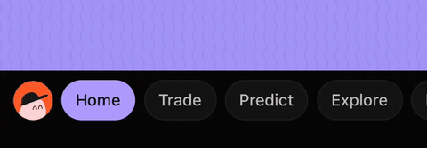</a><br><b>03 · Chip Rail</b><br><sub>Chip rail</sub></td><td align="center" width="50%"><a href="https://vanitascaesar1.github.io/tabcn/designs/sticker-tiles/">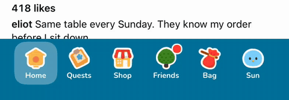</a><br><b>04 · Sticker Tiles</b><br><sub>Docked bar</sub></td></tr>
<tr><td align="center" width="50%"><a href="https://vanitascaesar1.github.io/tabcn/designs/segment-search/">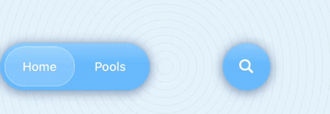</a><br><b>05 · Segment + Search</b><br><sub>Pill + action button</sub></td><td align="center" width="50%"><a href="https://vanitascaesar1.github.io/tabcn/designs/pill-plus/">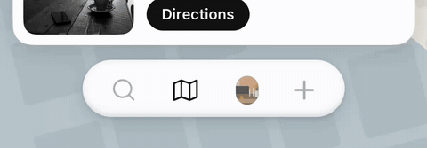</a><br><b>06 · Pill + Plus</b><br><sub>Pill + action button</sub></td></tr>
<tr><td align="center" width="50%"><a href="https://vanitascaesar1.github.io/tabcn/designs/solid-dark/">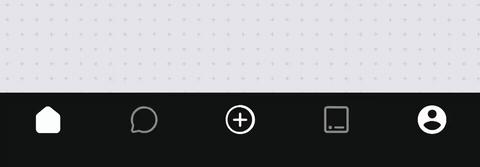</a><br><b>07 · Solid Dark</b><br><sub>Docked bar</sub></td><td align="center" width="50%"><a href="https://vanitascaesar1.github.io/tabcn/designs/outline-dark/"></a><br><b>08 · Outline Dark</b><br><sub>Docked bar</sub></td></tr>
<tr><td align="center" width="50%"><a href="https://vanitascaesar1.github.io/tabcn/designs/orbs/"></a><br><b>09 · Orbs</b><br><sub>Floating buttons</sub></td><td align="center" width="50%"><a href="https://vanitascaesar1.github.io/tabcn/designs/center-cta/"></a><br><b>10 · Center CTA</b><br><sub>Center action</sub></td></tr>
<tr><td align="center" width="50%"><a href="https://vanitascaesar1.github.io/tabcn/designs/soft-pill/"></a><br><b>11 · Soft Pill</b><br><sub>Floating pill</sub></td><td align="center" width="50%"><a href="https://vanitascaesar1.github.io/tabcn/designs/dark-capsule/"></a><br><b>12 · Dark Capsule</b><br><sub>Docked bar</sub></td></tr>
<tr><td align="center" width="50%"><a href="https://vanitascaesar1.github.io/tabcn/designs/gradient-stickers/">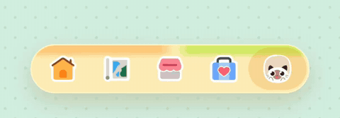</a><br><b>13 · Gradient Stickers</b><br><sub>Floating pill</sub></td><td align="center" width="50%"><a href="https://vanitascaesar1.github.io/tabcn/designs/light-icons/"></a><br><b>14 · Dark Icons</b><br><sub>Docked bar</sub></td></tr>
<tr><td align="center" width="50%"><a href="https://vanitascaesar1.github.io/tabcn/designs/playful-tiles/"></a><br><b>15 · Playful Tiles</b><br><sub>Docked bar</sub></td><td align="center" width="50%"><a href="https://vanitascaesar1.github.io/tabcn/designs/sliding-capsule/"></a><br><b>16 · Sliding Capsule</b><br><sub>Floating pill</sub></td></tr>
<tr><td align="center" width="50%"><a href="https://vanitascaesar1.github.io/tabcn/designs/labeled-plus/"></a><br><b>17 · Labeled + Plus</b><br><sub>Pill + action button</sub></td><td align="center" width="50%"><a href="https://vanitascaesar1.github.io/tabcn/designs/frosted-media/"></a><br><b>18 · Frosted Media</b><br><sub>Floating pill</sub></td></tr>
<tr><td align="center" width="50%"><a href="https://vanitascaesar1.github.io/tabcn/designs/glow-glass/">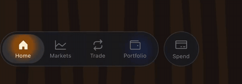</a><br><b>19 · Glow Glass</b><br><sub>Pill + action button</sub></td><td align="center" width="50%"><a href="https://vanitascaesar1.github.io/tabcn/designs/mono-type/"></a><br><b>20 · Mono Type</b><br><sub>Docked bar</sub></td></tr>
<tr><td align="center" width="50%"><a href="https://vanitascaesar1.github.io/tabcn/designs/split-search/">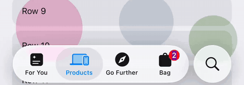</a><br><b>Split Search</b><br><sub>Pill + action button</sub></td><td align="center" width="50%"><a href="https://vanitascaesar1.github.io/tabcn/designs/material-pill/"></a><br><b>Material Pill</b><br><sub>Docked bar</sub></td></tr>
<tr><td align="center" width="50%"><a href="https://vanitascaesar1.github.io/tabcn/designs/side-rail/">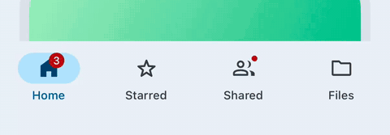</a><br><b>Side Rail</b><br><sub>Side rail</sub></td><td align="center" width="50%"><a href="https://vanitascaesar1.github.io/tabcn/designs/search-dock/"></a><br><b>Search Dock</b><br><sub>Floating buttons</sub></td></tr>
<tr><td align="center" width="50%"><a href="https://vanitascaesar1.github.io/tabcn/designs/button-row/"></a><br><b>Button Row</b><br><sub>Floating buttons</sub></td><td align="center" width="50%"><a href="https://vanitascaesar1.github.io/tabcn/designs/color-flood/">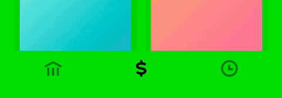</a><br><b>Colour Flood</b><br><sub>Docked bar</sub></td></tr>
<tr><td align="center" width="50%"><a href="https://vanitascaesar1.github.io/tabcn/designs/accent-dark/"></a><br><b>Accent Dark</b><br><sub>Docked bar</sub></td><td align="center" width="50%"><a href="https://vanitascaesar1.github.io/tabcn/designs/tile-plus/"></a><br><b>Tile Plus</b><br><sub>Center action</sub></td></tr>
<tr><td align="center" width="50%"><a href="https://vanitascaesar1.github.io/tabcn/designs/offset-plus/"></a><br><b>Offset Plus</b><br><sub>Center action</sub></td><td align="center" width="50%"><a href="https://vanitascaesar1.github.io/tabcn/designs/tinted-icons/">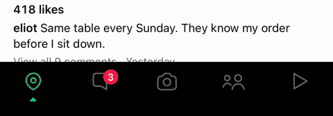</a><br><b>Tinted Icons</b><br><sub>Docked bar</sub></td></tr>
<tr><td align="center" width="50%"><a href="https://vanitascaesar1.github.io/tabcn/designs/badge-dock/">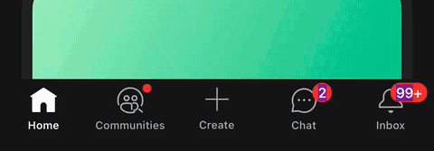</a><br><b>Badge Dock</b><br><sub>Docked bar</sub></td><td align="center" width="50%"><a href="https://vanitascaesar1.github.io/tabcn/designs/cart-pill/"></a><br><b>Cart Pill</b><br><sub>Pill + action button</sub></td></tr>
<tr><td align="center" width="50%"><a href="https://vanitascaesar1.github.io/tabcn/designs/glass-badges/">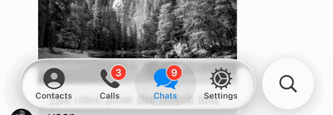</a><br><b>Glass Badges</b><br><sub>Pill + action button</sub></td><td align="center" width="50%"><a href="https://vanitascaesar1.github.io/tabcn/designs/section-sheet/"></a><br><b>Section Sheet</b><br><sub>Sheet</sub></td></tr>
<tr><td align="center" width="50%"><a href="https://vanitascaesar1.github.io/tabcn/designs/scrub-pill/">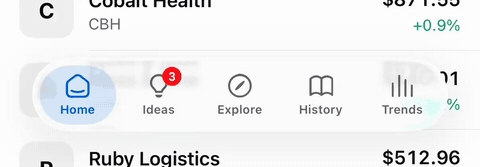</a><br><b>Scrub Pill</b><br><sub>Floating pill</sub></td><td align="center" width="50%"><a href="https://vanitascaesar1.github.io/tabcn/designs/live-tabs/"></a><br><b>Live Tabs</b><br><sub>Docked bar</sub></td></tr>
<tr><td align="center" width="50%"><a href="https://vanitascaesar1.github.io/tabcn/designs/composer-dock/">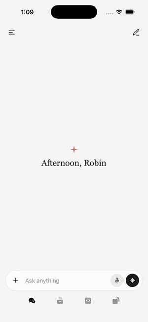</a><br><b>Composer Dock</b><br><sub>Docked bar</sub></td><td width="50%"></td></tr>
</table>

### Panels

Each is shown with the tab bar it pairs with in the example app. Mini Player, Context Tray, Bar Sheet and Companion Chip work with any tabcn bar; Quick Create needs a bar whose + button is marked with `usePanelAnchor('action')` (Labeled + Plus, Pill + Plus, Glow Glass, Segment + Search and Center CTA are), and Sub-Tabs a bar whose tab calls `useSubTabs(name)`.

<table>
<tr><td align="center" width="50%"><a href="https://vanitascaesar1.github.io/tabcn/designs/mini-player/"></a><br><b>Mini Player</b><br><sub> · with Soft Pill</sub></td><td align="center" width="50%"><a href="https://vanitascaesar1.github.io/tabcn/designs/context-tray/">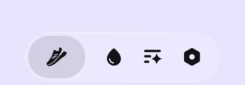</a><br><b>Context Tray</b><br><sub> · with Glass Expand</sub></td></tr>
<tr><td align="center" width="50%"><a href="https://vanitascaesar1.github.io/tabcn/designs/quick-create/"></a><br><b>Quick Create</b><br><sub> · with Labeled + Plus</sub></td><td align="center" width="50%"><a href="https://vanitascaesar1.github.io/tabcn/designs/bar-sheet/"></a><br><b>Bar Sheet</b><br><sub>with Soft Pill</sub></td></tr>
<tr><td align="center" width="50%"><a href="https://vanitascaesar1.github.io/tabcn/designs/companion-chip/">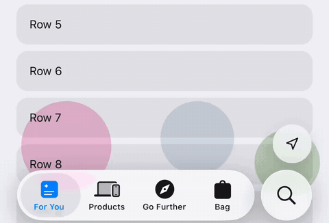</a><br><b>Companion Chip</b><br><sub>with Split Search</sub></td><td align="center" width="50%"><a href="https://vanitascaesar1.github.io/tabcn/designs/sub-tabs/"></a><br><b>Sub-Tabs</b><br><sub>with a Soft Pill copy</sub></td></tr>
</table>

## Repository layout

```
apps/example/      Expo SDK 58 app (Expo Router) that shows every design
apps/site/         the website (Next.js, static export to GitHub Pages)
packages/tabcn/    the foundation npm package
registry/          the copyable designs, one folder each
docs/designs/      design docs, written before the code they describe
references/        local-only reference images (git-ignored; see its README)
tools/trace/       scripts that traced the designs' icons from the references
```

## Try it on your phone

Install [Expo Go](https://expo.dev/go), then scan the QR code on any design's page on the site. It opens the example app, published with EAS Update, straight on that design. The app's gallery lists all 42, and its React Navigation screen runs each design under `@react-navigation/bottom-tabs`.

## Development

Requires [Bun](https://bun.sh) 1.4+ and Node 22+. iOS needs Xcode; Android needs Android Studio.

```bash
bun install        # install everything (workspaces)
bun run example    # start Metro for the example app
bun run ios        # or open it in the iOS simulator
bun run check      # lint + typecheck + registry check + tests + build, the same as CI
```

The example app imports `react-native-tabcn` from `packages/tabcn/src` directly (through the `tabcn-source` export condition), so edits to the package show up on reload with no build step.

See [CONTRIBUTING.md](CONTRIBUTING.md) for the workflow and release process.

## Credits

Made by Chakravarthi Chintapatla ([@phantommenace_x](https://x.com/phantommenace_x) on X).

The first 20 tab bars recreate the ones collected in the "tab bar pillars" post by [@jaimintf](https://x.com/jaimintf/status/2123071132224077889).

## License

[MIT](LICENSE)
